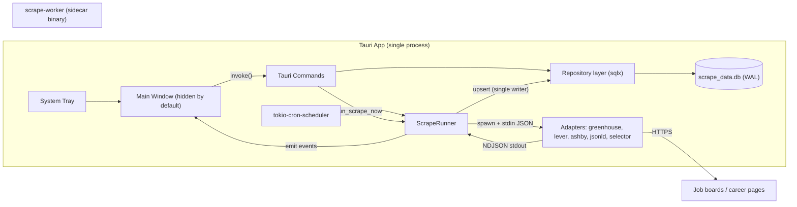
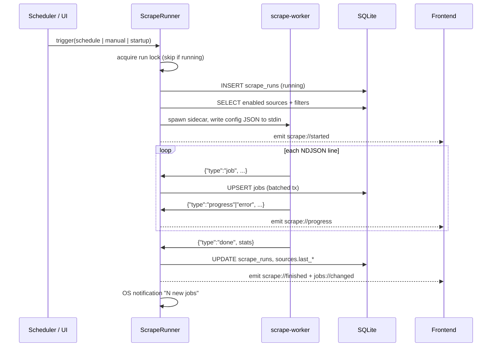
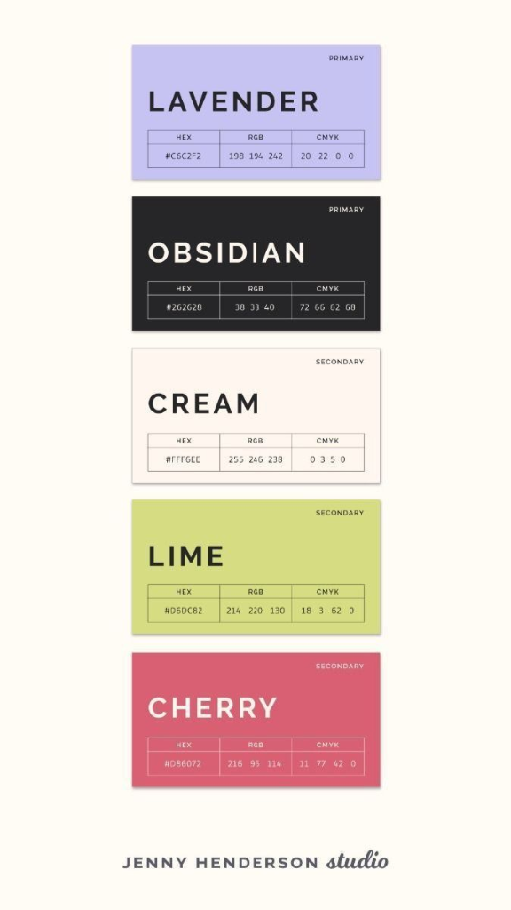
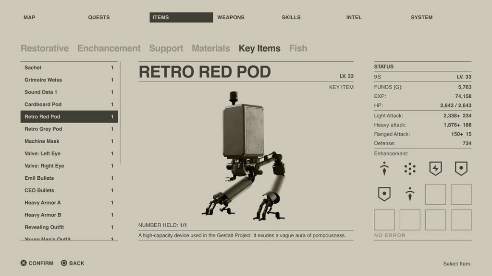
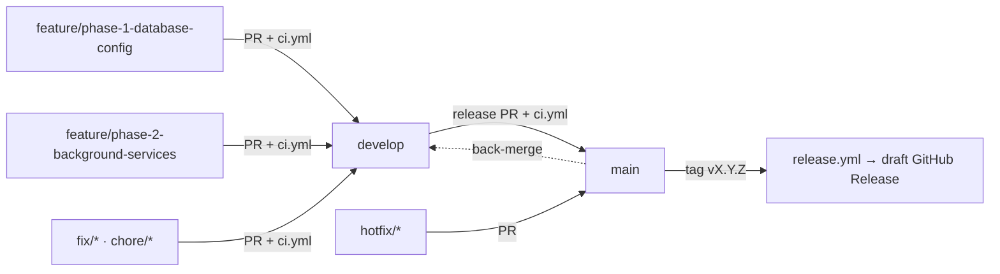

# Project Scrape — Master Plan

> Local-first job scraper + application tracker. Runs silently in the system tray, scrapes job boards on a CRON schedule, and presents a stark PS2-era / NieR:Automata brutalist UI for triage, tracking, and metrics.

| Status | Owner | Last updated |
|---|---|---|
| 📝 Draft — awaiting review | Samir | 2026-10-09 |

---

## 1. Sub-plan Index

Each phase is a self-contained, shippable increment. Implement in order; every sub-plan ends with acceptance criteria that must pass before moving on.

| # | Sub-plan | Delivers | Depends on |
|---|---|---|---|
| 1 | [Database & Configuration](./01-database-config.md) | Repo scaffold, SQLite schema + migrations, Rust DB layer, Tauri commands, OS-derived defaults | — |
| 2 | [Background Services](./02-background-services.md) | Tray-first app lifecycle, CRON scheduler, `scrape-worker` sidecar (ATS APIs + company pages) | 1 |
| 3 | [Frontend & Brutalist UI](./03-frontend-ui.md) | Design system (Tailwind v4 tokens), shell, 4 views, keyboard nav | 1 (2 for live events) |
| 3.5 | [Job Enrichment, Custom Filters & Scraper Logs](./03b-enrichment-filters.md) | Salary, country/state/remote, sponsorship & clearance classification, dual-layer filtering, RangeSlider, logo removal, Settings Logs with red square error markers | 3 |
| 4 | [Metrics Dashboard](./04-metrics-dashboard.md) | Visx charts, metric cards, Rust metrics aggregation | 1, 3 |
| 5 | [CI/CD](./05-ci-cd.md) | PR checks + tag-triggered cross-platform release builds | 1–2 (sidecar build script) |
| — | [Error Log & Solutions](./errors/solutions.md) | Living troubleshooting runbook; recorded errors, causes, and solutions | Ongoing |

---

## 2. Locked Decisions

| Area | Decision | Why |
|---|---|---|
| Shell | **Tauri v2** | Tray, sidecars, plugins, small bundles. |
| Frontend | **React 19 + TypeScript + Vite** | Required by Visx; largest ecosystem. |
| Styling | **Tailwind CSS v4** (`@tailwindcss/vite`, CSS-first `@theme`) + hand-written components | No UI kits (no Shadcn, MUI, etc.). |
| Charts | **Visx** | Raw SVG → full control over flat/monochrome/dithered styling. |
| DB | **SQLite via `sqlx`** (async, compile-time migrations) | Fits tokio runtime used by Tauri + scheduler. |
| Scheduler | **`tokio-cron-scheduler`** | Requested; runs on Tauri's tokio runtime. |
| Scraper | **Separate Rust binary `scrape-worker`, bundled as a Tauri sidecar** | One toolchain, trivial cross-compile in CI, isolated crashes. |
| Sources (v1) | **Greenhouse, Lever, Ashby public JSON APIs** + **company career pages** (JSON-LD `JobPosting`, CSS selectors, embedded-ATS auto-detect) | Stable + ToS-friendly; company pages for coverage. |
| Rust↔TS types | **`ts-rs`** generates TS types from Rust structs | Single source of truth for DTOs. |
| Frontend data | **TanStack Query** (cache/invalidate) + **Zustand** (UI state) | Small, no boilerplate. |

### 2.1 Proposed deviations from the original brief (please confirm)

> [!IMPORTANT]
> These are deliberate changes I'm recommending. Each is easy to revert — flag any you disagree with.

1. **Sidecar does not write to SQLite directly.** It streams NDJSON (`job`, `progress`, `error`, `done`) on stdout; the host is the **single writer** and upserts in transactions. Avoids `SQLITE_BUSY` contention, keeps schema ownership in one place, and makes the worker trivially testable (`scrape-worker --source greenhouse:stripe | jq`).
2. **Config is passed via stdin JSON, not CLI args.** Avoids Windows command-line length/quoting limits when there are many target URLs. CLI flags are still supported for manual debugging.
3. **Target URLs live in a dedicated `sources` table**, not a JSON blob in `app_settings` — each source needs its own kind, config, enabled flag, and last-run status.
4. **Extended `status` enum:** `scraped, viewed, applied, interviewing, offer, rejected, ignored`. The Tracked Kanban needs pipeline stages beyond `applied`.
5. **Added `role_type = unknown`.** Greenhouse and most HTML pages don't expose employment type; defaulting to "Full-time" would corrupt the Job Types chart. A keyword heuristic runs first; `unknown` is the fallback.
6. **Added `job_status_events` table.** "Applications over time" and "Current streak" need *when* a job became `applied`, which a single `status` column can't provide.
7. **Salary data extraction and storage:** Structured annualization (`salary_min`, `salary_max`, `salary_currency`, `salary_interval`, `salary_raw`, `salary_source`). Extracted from structured ATS endpoints (Lever `salaryRange`, Ashby `summaryComponents`, JSON-LD `baseSalary`, Greenhouse `pay_input_ranges`) and contextual regex fallback.
8. **Structured Location (Country / State / Remote):** Normalization of multi-location listings into a `job_locations` child table (`city`, `region_code` ISO 3166-2, `country_code` ISO 3166-1 alpha-2, `is_remote`) via an embedded gazetteer.
9. **Sponsorship & Clearance classification:** Per-sentence text classifier in `scrape-core::enrich::eligibility` classifying descriptions into `YES` / `NO` / `N/A`, preserving the exact evidence quote and clearance level.
10. **Dual-Layer Custom Filtering & RangeSlider:** Separation between **scraper ingestion filters** (Settings → SCRAPER → ADVANCED) and **UI view filters** (Discovered & Tracked). Customizable by country, state/region, salary range slider with synced number inputs (0 – $500K+), and sponsorship/clearance tri-states (`YES` / `NO` / `N/A`).
11. **Removal of "SCRAPE" Logo & Zero Flavor Text:** Stripped the `SCRAPE // SYS.02` logo from TopNav (tabs begin flush left). Strictly removed all vanity copy across the app.
12. **Scraper Execution Logs in Settings (Red Square Indicator):** Dedicated "LOGS" tab in Settings (`SettingsCategory = 'logs'`). Scraper run logs are sorted chronologically by date and time (newest first). Any run or event encountering issues needing user attention (e.g. sidecar errors, network timeouts, HTTP 403/429 rate limits, adapter parsing errors) is marked with a prominent brutalist red square (`■`). Selecting a run provides full diagnostic log inspection.

---

## 3. Architecture



### 3.1 Scrape run sequence



---

## 4. Repository Layout (target)

```
scrape/
├── plans/                         # ← you are here
│   ├── errors/solutions.md        # living error log & resolution runbook
│   └── assets/                    # visual references
├── .github/workflows/
│   ├── ci.yml                     # PR checks (Phase 5)
│   └── release.yml                # tag-triggered builds (Phase 5)
├── Cargo.toml                     # Rust workspace root
├── crates/
│   ├── scrape-core/               # shared types: RoleType, JobStatus, NDJSON protocol, role heuristics
│   └── scrape-worker/             # sidecar binary: HTTP + adapters
├── src-tauri/                     # Tauri host crate
│   ├── migrations/                # sqlx SQL migrations
│   ├── binaries/                  # sidecar output (gitignored), named with target triple
│   ├── capabilities/default.json
│   ├── icons/
│   ├── src/
│   │   ├── main.rs / lib.rs
│   │   ├── db/ (mod.rs, jobs.rs, settings.rs, sources.rs, runs.rs, metrics.rs)
│   │   ├── commands/ (jobs.rs, settings.rs, sources.rs, scrape.rs, metrics.rs)
│   │   ├── services/ (scheduler.rs, runner.rs, tray.rs, system.rs)
│   │   └── error.rs, state.rs
│   └── tauri.conf.json
├── scripts/
│   └── build-sidecar.mjs          # builds worker for TAURI_ENV_TARGET_TRIPLE, copies into binaries/
├── src/                           # React app
│   ├── bindings/                  # ts-rs generated (committed)
│   ├── components/{ui,layout}/
│   ├── views/{Discovered,Tracked,Metrics,Settings}/
│   ├── lib/ (api.ts, events.ts, format.ts)
│   ├── state/ (ui.ts)
│   └── styles/index.css
├── package.json
└── vite.config.ts
```

---

## 5. Design Direction (summary — full spec in [Phase 3](./03-frontend-ui.md))

| Palette reference | Dither reference | Layout reference |
|---|---|---|
|  |  |  |

- **Layout** mirrors the NieR menu: top tab bar (inverted block = active), muted large sub-filter row, 3-column body (list · detail · status panel), footer key hints.
- **Palette:** Paper `#F5F5DC`, Ink `#1A1A1A`, Obsidian `#262628`, Cream `#FFF6EE`, Lavender `#C6C2F2`, Lime `#D6DC82`, Cherry `#D86072`, + optional Signal Blue for halftone/dither accents.
- **Rules:** zero border-radius everywhere, 1px rules, uppercase tracked-tight sans, halftone/dot-matrix dithering via CSS patterns, `image-rendering: pixelated`, `shape-rendering: crispEdges` in charts.

---

## 6. Milestones & Definition of Done

| Milestone | Demo-able outcome |
|---|---|
| **M1** (Phase 1) | `npm run tauri dev` opens a window; DB file is created in app-data dir with defaults; commands callable from devtools. |
| **M2** (Phase 2) | App boots to tray only; a source added via command is scraped on schedule + "run now"; jobs land in DB; OS notification fires. |
| **M3** (Phase 3) | Full UI: triage inbox with keyboard, Kanban tracking, settings for schedule/sources/filters/theme. |
| **M4** (Phase 4) | Metrics tab with 2 charts + 3 cards driven by real data. |
| **M5** (Phase 5) | Pushing `v0.1.0` produces draft GitHub Release with `.dmg/.app`, `.msi/.exe`, `.deb/.AppImage`. |

**Global quality bar** (every phase):
- `cargo fmt --check`, `cargo clippy -D warnings`, `cargo test`, `tsc --noEmit`, `vitest run` all green.
- **Error Knowledge Base:** Any unexpected compile, test, or runtime issue must be documented with its root cause and verified resolution in [`plans/errors/solutions.md`](./errors/solutions.md) to prevent regressions across phases.

---

## 7. Git Branching & GitHub Actions



| Branch | Purpose | Protection (GitHub ruleset) | Actions |
|---|---|---|---|
| `main` | Released, stable code. Every commit is taggable. | PR required, `ci` check must pass, linear history, no force-push/delete | `ci.yml` on push + PR; tags `v*.*.*` trigger `release.yml` |
| `develop` | Integration branch; default target for PRs. | PR required, `ci` check must pass, no force-push | `ci.yml` on push + PR |
| `feature/phase-N-<slug>` | One branch per sub-plan (or sub-task of one). | — | `ci.yml` on PR |
| `fix/*`, `chore/*`, `docs/*` | Small changes → `develop`. | — | `ci.yml` on PR |
| `hotfix/*` | Urgent fix off `main` → PR to `main`, then back-merge to `develop`. | — | `ci.yml` on PR |

- **Squash-merge** feature PRs into `develop`; **merge commit** for `develop → main` release PRs (keeps a clear release boundary).
- `release.yml` additionally verifies the tagged commit is reachable from `main` and the tag matches the app version.
- Conventional commit prefixes (`feat:`, `fix:`, `chore:`, `docs:`, `ci:`) for readable changelogs.
- Dependabot (cargo, npm, github-actions) opens weekly PRs against `develop`.
- `ci.yml` lands in Phase 1 so every phase PR is checked from day one; `release.yml` lands in Phase 5.

---

## 8. Risks & Mitigations

| Risk | Mitigation |
|---|---|
| JS-rendered career pages return empty HTML | v1 supports static HTML/JSON-LD + ATS auto-detect only; headless browser is out of scope (documented in UI when a source returns 0 jobs). |
| Site blocking / rate limiting | Honest UA, robots.txt check for HTML sources, per-host concurrency 1, exponential backoff, ATS APIs preferred. |
| Unsigned binaries → macOS Gatekeeper / SmartScreen warnings | Ship unsigned for v0.x; signing secrets wired as optional in Phase 5. |
| Linux tray inconsistency (GNOME) | Use `libayatana-appindicator`; document AppIndicator extension; "start hidden" can be disabled. |
| `tauri-build` errors if sidecar binary missing (fresh clone, rust-analyzer) | `build-sidecar.mjs` runs in `beforeDevCommand`/`beforeBuildCommand`; `npm run setup` builds it once. |
| `tokio-cron-scheduler` uses **6-field** cron (with seconds) | Store 6-field strings; UI offers presets + validates and previews next 3 run times. |

---

## 9. Out of Scope (v1)

LinkedIn/Indeed scraping · headless-browser scraping · cloud sync / accounts · auto-apply · auto-updater (hooks noted in Phase 5) · mobile.
