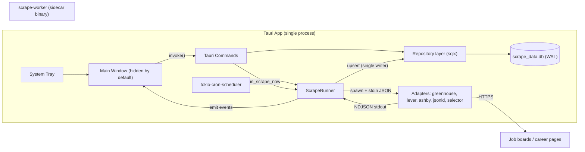
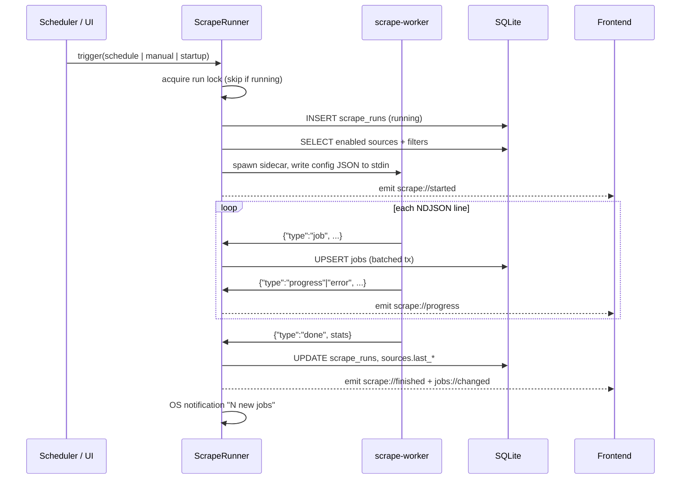
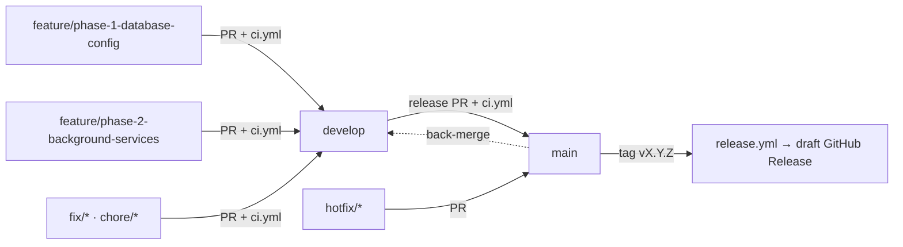

# Project Scrape — Master Plan

> Local-first job scraper + application tracker. Runs silently in the system tray, scrapes job boards on a CRON schedule, and presents a stark PS2-era / NieR:Automata brutalist UI for triage, tracking, and metrics.

| Status | Owner | Last updated |
|---|---|---|
| 📝 Draft — awaiting review | Samir | 2026-10-09 |

---

## 1. Sub-plan Index

Each phase is a self-contained, shippable increment. Implement in order; every sub-plan ends with acceptance criteria that must pass before moving on.

| # | Sub-plan | Delivers | Depends on |
|---|---|---|---|
| 1 | [Database & Configuration](./01-database-config.md) | Repo scaffold, SQLite schema + migrations, Rust DB layer, Tauri commands, OS-derived defaults | — |
| 2 | [Background Services](./02-background-services.md) | Tray-first app lifecycle, CRON scheduler, `scrape-worker` sidecar (ATS APIs + company pages) | 1 |
| 3 | [Frontend & Brutalist UI](./03-frontend-ui.md) | Design system (Tailwind v4 tokens), shell, 4 views, keyboard nav | 1 (2 for live events) |
| 3.5 | [Job Enrichment, Custom Filters, YOE & Scraper Logs](./03b-enrichment-filters.md) | Salary, country/state/remote, sponsorship & clearance, YOE & New Grad classification, dual-layer filtering, RangeSlider, logo removal, dedicated Scraper tab with red square error markers, custom CSS+Regex scraper | 3 |
| 3.7 | [Autonomous Scrape Workflows, Data Retention & Observability](./03c-custom-scrape-jobs.md) | Airflow-style DAG registry, unified per-workflow Schedule & Ingestion Filters, TTL Data Retention & Favorites Protection, Dual-Mode YAML Spec v2 with Live Validation, Bottom-Right Error Toasts | 3.5 |
| 3.8 | [Workflow Ergonomics, System Formats, Typography & Anchored Dropdowns](./03d-ergonomics-typography-filters.md) | Clock manual typing & system 12H/24H formats, modal-scoped workflow modes & cadence exclusivity, Contains & hourly salary filters, zero-intersection tooltips & global toggle, Appearance typography font switcher with isolated specimens, trigger-anchored filter dropdown | 3.7 |
| 3.9 | [Notification Center, In-App Updates & Tauri Updater](./03e-notifications-and-updater.md) | Brutalist notification bell in TopNav, anchored popover center, tauri-plugin-updater integration, auto-update toggle, update channel selector | 3.8 |
| 4 | [Metrics Dashboard](./04-metrics-dashboard.md) | Visx charts, metric cards, Rust metrics aggregation | 1, 3 |
| 5 | [CI/CD](./05-ci-cd.md) | PR checks + tag-triggered cross-platform release builds | 1–2 (sidecar build script) |
| — | [Error Log & Solutions](./errors/solutions.md) | Living troubleshooting runbook; recorded errors, causes, and solutions | Ongoing |

---

## 2. Locked Decisions

| Area | Decision | Why |
|---|---|---|
| Shell | **Tauri v2** | Tray, sidecars, plugins, small bundles. |
| Frontend | **React 19 + TypeScript + Vite** | Required by Visx; largest ecosystem. |
| Styling | **Tailwind CSS v4** (`@tailwindcss/vite`, CSS-first `@theme`) + hand-written components | No UI kits (no Shadcn, MUI, etc.). |
| Charts | **Visx** | Raw SVG → full control over flat/monochrome/dithered styling. |
| DB | **SQLite via `sqlx`** (async, compile-time migrations) | Fits tokio runtime used by Tauri + scheduler. |
| Scheduler | **`tokio-cron-scheduler`** | Requested; runs on Tauri's tokio runtime. |
| Scraper | **Separate Rust binary `scrape-worker`, bundled as a Tauri sidecar** | One toolchain, trivial cross-compile in CI, isolated crashes. |
| Sources (v1) | **Greenhouse, Lever, Ashby public JSON APIs** + **company career pages** (JSON-LD `JobPosting`, CSS selectors, embedded-ATS auto-detect) | Stable + ToS-friendly; company pages for coverage. |
| Rust↔TS types | **`ts-rs`** generates TS types from Rust structs | Single source of truth for DTOs. |
| Frontend data | **TanStack Query** (cache/invalidate) + **Zustand** (UI state) | Small, no boilerplate. |

### 2.1 Proposed deviations from the original brief (please confirm)

> [!IMPORTANT]
> These are deliberate changes I'm recommending. Each is easy to revert — flag any you disagree with.

1. **Sidecar does not write to SQLite directly.** It streams NDJSON (`job`, `progress`, `error`, `done`) on stdout; the host is the **single writer** and upserts in transactions. Avoids `SQLITE_BUSY` contention, keeps schema ownership in one place, and makes the worker trivially testable (`scrape-worker --source greenhouse:stripe | jq`).
2. **Config is passed via stdin JSON, not CLI args.** Avoids Windows command-line length/quoting limits when there are many target URLs. CLI flags are still supported for manual debugging.
3. **Target URLs live in a dedicated `sources` table**, not a JSON blob in `app_settings` — each source needs its own kind, config, enabled flag, and last-run status.
4. **Extended `status` enum:** `scraped, viewed, applied, interviewing, offer, rejected, ignored`. The Tracked Kanban needs pipeline stages beyond `applied`.
5. **Added `role_type = unknown`.** Greenhouse and most HTML pages don't expose employment type; defaulting to "Full-time" would corrupt the Job Types chart. A keyword heuristic runs first; `unknown` is the fallback.
6. **Added `job_status_events` table.** "Applications over time" and "Current streak" need *when* a job became `applied`, which a single `status` column can't provide.
7. **Salary data extraction and storage:** Structured annualization (`salary_min`, `salary_max`, `salary_currency`, `salary_interval`, `salary_raw`, `salary_source`). Extracted from structured ATS endpoints (Lever `salaryRange`, Ashby `summaryComponents`, JSON-LD `baseSalary`, Greenhouse `pay_input_ranges`) and contextual regex fallback.
8. **Structured Location (Country / State / Remote):** Normalization of multi-location listings into a `job_locations` child table (`city`, `region_code` ISO 3166-2, `country_code` ISO 3166-1 alpha-2, `is_remote`) via an embedded gazetteer.
9. **Sponsorship & Clearance classification:** Per-sentence text classifier in `scrape-core::enrich::eligibility` classifying descriptions into `YES` / `NO` / `N/A`, preserving the exact evidence quote and clearance level.
10. **Dual-Layer Custom Filtering & RangeSlider:** Separation between **scraper ingestion filters** (SCRAPER → FILTERS) and **UI view filters** (Discovered & Tracked). Customizable by country, state/region, salary range slider with synced number inputs (0 – $500K+), and sponsorship/clearance tri-states (`YES` / `NO` / `N/A`).
11. **Removal of "SCRAPE" Logo & Zero Flavor Text:** Stripped the `SCRAPE // SYS.02` logo from TopNav (tabs begin flush left). Strictly removed all vanity copy across the app.
12. **Scraper Execution Logs (Red Square Indicator):** Dedicated "LOGS" view in the top-level SCRAPER tab (`scraperCategory = 'logs'`). Scraper run logs are sorted chronologically by date and time (newest first). Any run or event encountering issues needing user attention (e.g. sidecar errors, network timeouts, HTTP 403/429 rate limits, adapter parsing errors) is marked with a prominent brutalist red square (`■`). Selecting a run provides full diagnostic log inspection.
13. **Theme-Synchronized Brutalist Scrollbars:** Complete elimination of default OS scrollbars. Custom scrollbars use strict 0px border-radius, thin 8px geometry, `var(--color-paper-2)` track with 1px ink boundary, and `var(--color-ink-mute)` thumb inverting to `var(--color-ink)` on hover, reacting dynamically to active theme tokens (Paper & Obsidian).
14. **Mandatory Automated Test Coverage for All Features:** Every suggested feature, parser, filter permutation, schema addition, and UI interaction must be accompanied by relevant unit and component tests before being marked complete.
15. **Feature-Branch Development Discipline:** Strict workflow requirement: All development must occur on isolated feature branches (`feature/<name>`) created from `develop`. No unverified code is pushed directly to mainline branches.
16. **Years of Experience (YOE) & New Grad Classification, Filtering, and Columns:** Structured extraction of minimum and maximum required years of experience (`experience_min`, `experience_max`, `experience_raw`) and new graduate eligibility (`is_new_grad: 'yes' | 'no' | 'unknown'`) via title heuristics and description regex in `scrape-core::enrich::experience`. Consolidated into a unified **"YEARS OF EXPERIENCE & LEVEL"** filter component in the filter engine (combining career stage presets `NEW GRAD (0-1)`, `MID (1-3)`, `SENIOR (3-5)`, `STAFF+ (5+)` with custom numerical bounds and inline New Grad eligibility options), eliminating redundant disparate filter sections while preserving sortable table columns in Tracked list view.
17. **Cascading Country & State/Province Dropdowns with Location Auto-Detection:** Replaced manual tag inputs in `LocationFilter` with cascading dropdown controls. Selecting a Country filters the available States & Provinces dropdown to that country's subdivisions. Added optional system/user location auto-detection (via browser geolocation API with permission, and system locale/timezone fallback) to pre-select local geography.
18. **Dual-Thumb Salary RangeSlider Pointer-Events Fix:** Fixed the dual `<input type="range">` overlay bug where one thumb was captured by the higher z-index track. Styled inputs with `pointer-events-none` on the track and `pointer-events-auto` exclusively on slider thumbs with dynamic z-index switching, guaranteeing both minimum and maximum thumbs are always independently controllable.
19. **Seasonal Employment Type Support:** Added `Seasonal` to `RoleType` (`RoleType::Seasonal` / `"seasonal"`), adding ATS hint and title heuristics, database schema CHECK constraint migration, backend metrics rollups, and unified filter controls.
20. **Dedicated Top-Level Scraper Tab:** Migrated all scraping operations from `Settings` into a dedicated, top-level **`SCRAPER`** tab (`DISCOVERED`, `TRACKED`, `METRICS`, `SCRAPER`, `SETTINGS`). The Scraper tab serves as the unified operational hub for `SOURCES` (job board configurations), `SCHEDULE` (cron automation & Run Now), `FILTERS` (ingestion-level keyword, location, and role filters), and `LOGS` (chronological run history with red square error indicators). The `SETTINGS` tab is streamlined to exclusively house application preferences (`APPEARANCE` and `SYSTEM`).
21. **Custom Regex & Selector Scraping Engine:** Empowered users to configure custom scrape jobs on arbitrary career pages using custom CSS selectors combined with regular expression capture rules (`item_selector`, `title_regex`, `link_regex`, `location_regex`, `salary_regex`, or direct text block regex). Includes live modal testing with previews before persisting the source.
22. **Tracked Kanban Board Alignment & 2D Navigation Engine:** Fixed column header seam bleeds (visible 1px dividers), standardized header height to `h-9` matching `SubNav` with stage telemetry (`// 0X`) and `STATUS_CONFIG` status pips, replaced width-capping `max-w-sm` with responsive CSS Grid `grid-cols-4 min-w-[1120px] divide-x`, stabilized scrollbar gutters across all columns, and added pure 2D matrix keyboard navigation (`j/k` vertical, `h/l` cross-column, `Shift+←/→` pipeline stage shift).
23. **Ref-Stabilized Desktop Hotkeys & Self-Healing 2D Kanban Navigation Engine:** Fixed cross-view selection orphan bug where navigating from Discovered to Tracked left `selectedJobId` unvalidated, causing horizontal left-navigation to lock up at Column 0. Implemented view selection self-healing in `TrackedView`, ref-stabilized keyboard listeners in `useHotkeys` (eliminating per-keystroke listener churn), bidirectional boundary support for orphaned IDs in `navigateHorizontal`, symmetrical Vim keybindings (`Shift+H`/`Shift+L` stage shifting alongside `Shift+←/→`), modifier guards (`!isModKey`), and synchronized footer navigation key hints.
24. **Two-Tier Hotkey Architecture & Global Root Shell Navigation:** Decoupled application shell hotkeys (tab switching `Q`/`E`/`[`/`]`, global search `/`, filter panel `F`, `Escape`) into `useGlobalHotkeys`, mounted permanently at the application root (`App.tsx`). This resolves the lifecycle bug where navigating to `Metrics`, `Scraper`, or `Settings` unmounted child-view hotkey listeners, permanently locking the user out of keyboard tab cycling. Leaf views (`DiscoveredView` and `TrackedView`) retain isolated, view-specific hotkeys via `useHotkeys` without duplicate listener registration.
25. **Capture-Phase Modal Window Dismissals (ESC Key Ergonomics):** Equipped `<Modal>` (and all overlay window/drawer components) with capture-phase `window` listeners (`useCapture` flag set to `true`). Intercepts `Escape` at the window capture root prior to child input blurring or background global handlers, guaranteeing instant, single-keypress dismissal of dialog windows (such as "ADD SCRAPE JOB") regardless of active focus or input state.
26. **Interactive Clock Schedule Picker & Dual Schedule Tabs (Google Clock UX):** Replaced legacy 4-button cron presets in Scraper → Schedule with an interactive Google-style clock picker (`ClockPicker.tsx`) paired with a discrete tab selector (`[■ CLOCK SCHEDULE]` vs `[≡ CUSTOM CRON]`). Features digital HH:MM readout, AM/PM toggle, SVG circular dial with polar coordinate snapping ($30^\circ$ hours, $6^\circ$ minutes), pointer capture dragging, automatic mode transition from hour to minute on release, cadence selection (Daily, Weekdays, Weekends, Every 12h, Every 6h, Hourly), and bidirectional 6-field tokio-cron synchronization with `cronToClock` and `clockToCron`.
27. **Autonomous Scrape Workflows (Airflow/Cloud Composer Paradigm):** Eliminate standalone Scraper → Schedule and Scraper → Filters root tabs. Consolidate into `WORKFLOWS` (Airflow-style DAG registry & inspector) and `EXECUTION LOGS` (observability hub with red square `■` diagnostics). Each workflow encapsulates its own extractor, schedule (Google ClockPicker / custom cron), ingestion filters, and retention policy.
28. **Workflow-Level Data Retention Engine (TTL Policy):** Each workflow specifies `retention_days` (default 30 days; 0 = keep forever) and `retention_policy` (`untracked_only` vs `all`). Untracked postings older than the threshold are automatically pruned post-run and during scheduled sweeps.
29. **Job Favoriting & Multi-Tier Retention Safety Shield:** Added `favorited` column and `favorited_at` timestamp to `jobs`, with keybinding `S` for quick toggle in Discovered and Tracked views. Data retention strictly protects user-tracked postings (`applied`, `interviewing`, `offer`, `rejected`), postings with user notes (`notes IS NOT NULL AND notes != ''`), AND favorited postings (`favorited = 1`), guaranteeing they are permanently safeguarded against automated pruning.
30. **Dual-Mode Workflow Editor & Declarative YAML Specification v2:** Modal editor provides seamless 100% bidirectional live synchronization between visual form controls (embedding `ClockPicker`, filter chips, retention slider) and declarative YAML v2 specifications (`version: 2`, `metadata`, `extractor`, `schedule`, `filters`, `retention`).
31. **Real-Time YAML Live Validation & Bottom-Right Error Toasts:** The workflow YAML editor provides live parseability feedback (valid badge vs line-numbered syntax/parameter errors). Attempting to save invalid YAML blocks persistence and triggers an auto-dismissing brutalist error toast in the bottom-right corner.
32. **Clock Manual Typing & Reactive System Date/Time Formats:** Separated typing input buffer from committed state in `ClockPicker.tsx`, resolving the bug where typing an hour defaulted to 12. Persisted `system_time_format` (12H vs 24H) and `system_date_format` (MM/DD/YYYY vs DD/MM/YYYY) in SQLite settings, dynamically syncing military vs 12-hour clock dials and date formatting.
33. **Workflow Modal Ergonomics & Cadence Mutual Exclusivity:** Scoped the Simple vs Advanced mode switch strictly inside the `AddSourceModal` window. Enforced clean mutual exclusivity between Preset Cadence and Clock Time (in Simple mode), and between Clock Time and Custom CRON (in Advanced mode). Provided direct YAML v2 import and export.
34. **Query-Level Contains Filter & Hourly Rate Interval Toggle:** Added a `CONTAINS (KEYWORDS / TEXT)` search filter to `FilterPanel.tsx` in both Discovered and Tracked views. Added an Annual vs Hourly interval toggle in `SalaryRangeFilter.tsx` (`$0 – $500k+/yr` vs `$0 – $250+/hr`) and stripped redundant flavour copy.
35. **Zero-Intersection Tooltip Engine & Global Tooltip Control:** Implemented CSS transform contact-edge pinning (`translate(-50%, -100%)` for top, `translate(-50%, 0)` for bottom) with a strict 6px separation gap and 12px viewport margins, eliminating trigger intersection and right-edge clipping. Added universal bottom-anchored hints across navigation tabs, view controls, and settings tabs, gated by a global `ui.tooltips_enabled` toggle.
36. **Appearance Typography & Isolated Typeface Specimen Previews:** Integrated 6 curated fonts (`SF Mono / System`, `Inter`, `JetBrains Mono`, `Geist Mono`, `Fira Code`, `IBM Plex Mono`) with reactive `data-font` CSS cascading. Implemented dedicated `.font-specimen-${id}` classes with `!important` declarations, guaranteeing each font card displays its own typeface specimen regardless of the active application font.
37. **Trigger-Anchored Dropdown Filter Menu:** Replaced the legacy right-side off-canvas drawer with an anchored popover dropdown tethered directly beneath the `[FILTERS [F]]` button in `SubNav`. Eliminates the 750px–1200px Fitts's law cursor travel penalty, uses `createPortal` with viewport boundary clamping, and removes the blocking modal backdrop so results filter reactively in plain view.
38. **Brutalist Notification Bell & In-App Notification Center:** Discrete geometric polygon bell icon in `TopNav` (far-right) with a solid square unread indicator (`■`). Tethered to an anchored popover notification center displaying categorized notifications (`UPDATE`, `SYSTEM`, `NEWS`, `SCRAPER`), individual mark-as-read, clear-all, and SQLite persistence in `app_notifications`.
39. **Tauri v2 Updater Integration & Custom Update State Machine:** Native integration of `tauri-plugin-updater` with `"dialog": false` to strictly suppress intrusive OS dialogs. Implemented an in-app update state machine (`IDLE` → `AVAILABLE` → `DOWNLOADING` with chunk stream progress → `READY` prompt) using `tauri-plugin-process` for application relaunch. Configured with minisign/Ed25519 signature verification and graceful developer-mode fallback.
40. **Automatic Update Preferences & Update Channel Control:** Settings → System controls allowing users to disable background update checks on launch (`app.auto_update: boolean`), select update channels (`[STABLE]` vs `[NIGHTLY]`), and trigger immediate manual update checks (`[CHECK FOR UPDATES NOW]`) with timestamped status telemetry.

### 2.2 Development & Branching Discipline (Strict Requirement)

To ensure codebase stability, prevent regressions, and enforce rigorous quality standards, the following workflow is mandatory for all ongoing and future work:

1. **Feature Branch Isolation:**
   - Every phase, feature, or enhancement MUST be developed on a dedicated feature branch created from `develop`:
     ```bash
     git checkout develop
     git pull origin develop
     git checkout -b feature/<phase-or-feature-name>
     ```
   - Never commit experimental or unverified changes directly to `develop` or `main`.
2. **Mandatory Test-Driven / Test-Covered Implementation:**
   - Every new feature, filter option, data model, or bugfix MUST include corresponding automated tests:
     - Rust core/backend: `cargo test --workspace` (adapters, parsers, classifiers, repos).
     - Frontend logic & state: `npm test` via Vitest (stores, API mocks, hotkeys, filters).
     - UI components: Vitest + Testing Library tests for interactive components and visual state logic.
3. **Local Dev Environment Verification Gate:**
   - Before any branch is merged into `develop`, the following verification matrix MUST pass with zero errors and zero warnings:
     ```bash
     npx tsc --noEmit        # TypeScript type-check
     npm test                # Frontend test suite
     cargo test --workspace  # Rust workspace test suite
     cargo clippy            # Rust linter
     npm run build           # Production asset bundle build
     ```
4. **Clean Merge Protocol:**
   - Once all tests pass and criteria are verified, the feature branch is merged into `develop` with a clear, conventional commit history.

## 3. Architecture



### 3.1 Scrape run sequence



---

## 4. Repository Layout (target)

```
scrape/
├── plans/                         # ← you are here
│   ├── errors/solutions.md        # living error log & resolution runbook
│   └── assets/                    # visual references
├── .github/workflows/
│   ├── ci.yml                     # PR checks (Phase 5)
│   └── release.yml                # tag-triggered builds (Phase 5)
├── Cargo.toml                     # Rust workspace root
├── crates/
│   ├── scrape-core/               # shared types: RoleType, JobStatus, NDJSON protocol, role heuristics
│   └── scrape-worker/             # sidecar binary: HTTP + adapters
├── src-tauri/                     # Tauri host crate
│   ├── migrations/                # sqlx SQL migrations
│   ├── binaries/                  # sidecar output (gitignored), named with target triple
│   ├── capabilities/default.json
│   ├── icons/
│   ├── src/
│   │   ├── main.rs / lib.rs
│   │   ├── db/ (mod.rs, jobs.rs, settings.rs, sources.rs, runs.rs, metrics.rs)
│   │   ├── commands/ (jobs.rs, settings.rs, sources.rs, scrape.rs, metrics.rs)
│   │   ├── services/ (scheduler.rs, runner.rs, tray.rs, system.rs)
│   │   └── error.rs, state.rs
│   └── tauri.conf.json
├── scripts/
│   └── build-sidecar.mjs          # builds worker for TAURI_ENV_TARGET_TRIPLE, copies into binaries/
├── src/                           # React app
│   ├── bindings/                  # ts-rs generated (committed)
│   ├── components/{ui,layout}/
│   ├── views/{Discovered,Tracked,Metrics,Scraper,Settings}/
│   ├── lib/ (api.ts, events.ts, format.ts)
│   ├── state/ (ui.ts)
│   └── styles/index.css
├── package.json
└── vite.config.ts
```

---

## 5. Design Direction (summary — full spec in [Phase 3](./03-frontend-ui.md))

| Palette reference | Dither reference | Layout reference |
|---|---|---|
|  |  |  |

- **Layout** mirrors the NieR menu: top tab bar (inverted block = active), muted large sub-filter row, 3-column body (list · detail · status panel), footer key hints.
- **Palette:** Paper `#F5F5DC`, Ink `#1A1A1A`, Obsidian `#262628`, Cream `#FFF6EE`, Lavender `#C6C2F2`, Lime `#D6DC82`, Cherry `#D86072`, + optional Signal Blue for halftone/dither accents.
- **Rules:** zero border-radius everywhere, 1px rules, uppercase tracked-tight sans, halftone/dot-matrix dithering via CSS patterns, `image-rendering: pixelated`, `shape-rendering: crispEdges` in charts.

---

## 6. Milestones & Definition of Done

| Milestone | Demo-able outcome |
|---|---|
| **M1** (Phase 1) | `npm run tauri dev` opens a window; DB file is created in app-data dir with defaults; commands callable from devtools. |
| **M2** (Phase 2) | App boots to tray only; a source added via command is scraped on schedule + "run now"; jobs land in DB; OS notification fires. |
| **M3** (Phase 3) | Full UI: triage inbox with keyboard, Kanban tracking, unified full-width Scraper operations hub with dual-mode engine (simple vs advanced), workflow-scoped execution logs, zero-intersection tooltips, typography switcher, trigger-anchored filter dropdown, and notification center with updater ([Phase 3.5](./03b-enrichment-filters.md), [Phase 3.7](./03c-custom-scrape-jobs.md), [Phase 3.8](./03d-ergonomics-typography-filters.md), [Phase 3.9](./03e-notifications-and-updater.md)), and application settings (appearance, system). |
| **M4** (Phase 4) | Metrics tab with 2 charts + 3 cards driven by real data. |
| **M5** (Phase 5) | Pushing `v0.1.0` produces draft GitHub Release with `.dmg/.app`, `.msi/.exe`, `.deb/.AppImage`. |

**Global quality bar** (every phase):
- `cargo fmt --check`, `cargo clippy -D warnings`, `cargo test`, `tsc --noEmit`, `vitest run` all green.
- **Error Knowledge Base:** Any unexpected compile, test, or runtime issue must be documented with its root cause and verified resolution in [`plans/errors/solutions.md`](./errors/solutions.md) to prevent regressions across phases.

---

## 7. Git Branching & GitHub Actions



| Branch | Purpose | Protection (GitHub ruleset) | Actions |
|---|---|---|---|
| `main` | Released, stable code. Every commit is taggable. | PR required, `ci` check must pass, linear history, no force-push/delete | `ci.yml` on push + PR; tags `v*.*.*` trigger `release.yml` |
| `develop` | Integration branch; default target for PRs. | PR required, `ci` check must pass, no force-push | `ci.yml` on push + PR |
| `feature/phase-N-<slug>` | One branch per sub-plan (or sub-task of one). | — | `ci.yml` on PR |
| `fix/*`, `chore/*`, `docs/*` | Small changes → `develop`. | — | `ci.yml` on PR |
| `hotfix/*` | Urgent fix off `main` → PR to `main`, then back-merge to `develop`. | — | `ci.yml` on PR |

- **Squash-merge** feature PRs into `develop`; **merge commit** for `develop → main` release PRs (keeps a clear release boundary).
- `release.yml` additionally verifies the tagged commit is reachable from `main` and the tag matches the app version.
- Conventional commit prefixes (`feat:`, `fix:`, `chore:`, `docs:`, `ci:`) for readable changelogs.
- Dependabot (cargo, npm, github-actions) opens weekly PRs against `develop`.
- `ci.yml` lands in Phase 1 so every phase PR is checked from day one; `release.yml` lands in Phase 5.

---

## 8. Risks & Mitigations

| Risk | Mitigation |
|---|---|
| JS-rendered career pages return empty HTML | v1 supports static HTML/JSON-LD + ATS auto-detect only; headless browser is out of scope (documented in UI when a source returns 0 jobs). |
| Site blocking / rate limiting | Honest UA, robots.txt check for HTML sources, per-host concurrency 1, exponential backoff, ATS APIs preferred. |
| Unsigned binaries → macOS Gatekeeper / SmartScreen warnings | Ship unsigned for v0.x; signing secrets wired as optional in Phase 5. |
| Linux tray inconsistency (GNOME) | Use `libayatana-appindicator`; document AppIndicator extension; "start hidden" can be disabled. |
| `tauri-build` errors if sidecar binary missing (fresh clone, rust-analyzer) | `build-sidecar.mjs` runs in `beforeDevCommand`/`beforeBuildCommand`; `npm run setup` builds it once. |
| `tokio-cron-scheduler` uses **6-field** cron (with seconds) | Store 6-field strings; UI offers presets + validates and previews next 3 run times. |

---

## 9. Out of Scope (v1)

LinkedIn/Indeed scraping · headless-browser scraping · cloud sync / accounts · auto-apply · auto-updater (hooks noted in Phase 5) · mobile.
