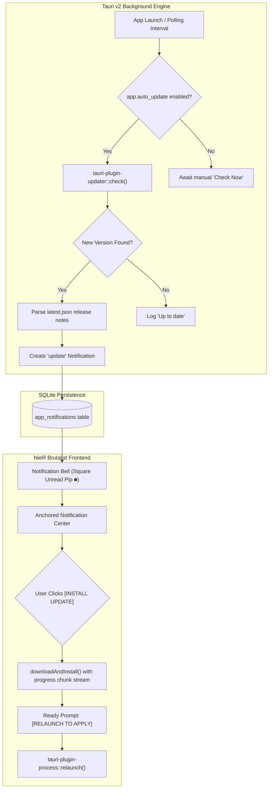

# Phase 3.9 — Notification Center, In-App Updates & Tauri Updater Integration

**Goal:** Provide a discrete, NieR:Automata brutalist notification center in the top-right menu bar, storing in-app notifications (app updates, release notes/news, system maintenance, and scrape error notices), paired with a seamless background update engine powered by `tauri-plugin-updater` with user-configurable auto-update controls.

← [Phase 3.8](./03d-ergonomics-typography-filters.md) · [Master Plan](./00-master-plan.md) · Next → [Phase 4](./04-metrics-dashboard.md)

---

## 1. Architectural Overview & Industry Patterns

Top production applications built on Tauri (such as GitButler, Spacedrive, and CrabNebula desktop tools) replace intrusive native operating system update dialogs with cohesive in-app notification centers.



---

## 2. Design Specification: NieR Brutalist Notification Center

### 2.1 The TopNav Notification Bell Button
Mounted on the far-right of `TopNav`, aligned with the header boundary and status telemetry:
- **Geometry:** Custom SVG polygon bell (trapezoidal tapered body, horizontal clapper bar, top loop, zero rounded borders).
- **Unread Badge:** Solid $6\text{px} \times 6\text{px}$ brutalist square pip (`■`) in `var(--color-cherry)` or `var(--color-signal)` anchored at the upper-right corner of the bell.
- **Hover/Active:** Flat inversion (`bg-[var(--color-ink)] text-[var(--color-paper)]`).
- **Hotkey / Accessibility:** Accessible via keyboard navigation and mouse click.

```
┌ DISCOVERED (42)  TRACKED (14)  METRICS  SCRAPER  SETTINGS ─── ● IDLE   [🔔 ■] ┐
```

### 2.2 Anchored Notification Popover
Tethered directly beneath the bell icon using `src/lib/positioning.ts` with `createPortal` and viewport clamping:
- **Dimensions:** $380\text{px}$ width, clamped to viewport safe margins (12px padding), 0px border-radius, 2px solid ink boundary, brutalist hard drop shadow (`shadow-[4px_4px_0px_0px_var(--color-ink)]`).
- **Header:**
  ```
  // NOTIFICATIONS [ 02 UNREAD ]                       [MARK ALL READ] [ESC]
  ```
- **Categories:**
  - `UPDATE`: New release available (e.g., `v0.2.0`), with download progress bar and `[INSTALL & RESTART]` action.
  - `NEWS / CHANGELOG`: Release notes, feature announcements, and developer notices.
  - `SYSTEM`: Data retention purges, backup completions, database maintenance summaries.
  - `SCRAPER`: Scrape execution warnings (rate limits, HTTP 403/429, parser anomalies).
- **Empty State:**
  ```
  NO UNREAD NOTIFICATIONS
  ALL SYSTEMS NOMINAL
  ```

---

## 3. Settings Menu: Update Controls (`SystemSettings.tsx`)

In **Settings → System**:

```
┌─ AUTOMATIC UPDATES ────────────────────────────────────────────────────────┐
│ [■] CHECK FOR UPDATES AUTOMATICALLY ON STARTUP                             │
│                                                                            │
│ UPDATE CHANNEL: [ STABLE (RECOMMENDED) ▾ ] [ NIGHTLY ]                     │
│                                                                            │
│ CURRENT VERSION: v0.1.0        LAST CHECKED: 10/11/2026 03:15              │
│                                                                            │
│ [CHECK FOR UPDATES NOW]   STATUS: UP TO DATE                               │
└────────────────────────────────────────────────────────────────────────────┘
```

1. **`app.auto_update` (boolean, default `true`):** Toggles automated background checks on application launch.
2. **`app.update_channel` ("stable" | "nightly", default "stable"):** Determines whether the updater reads from production releases or rolling nightly builds.
3. **`[CHECK FOR UPDATES NOW]` Button:** Queries the endpoint immediately, displays live state (`CHECKING...`, `UP TO DATE`, `ERROR`), and inserts an `UPDATE` notification if a new version is detected.

---

## 4. Technical Architecture

### 4.1 Backend Engine (`src-tauri`)
1. **Rust Dependencies:**
   - `tauri-plugin-updater = "2"`
   - `tauri-plugin-process = "2"` (for `relaunch()`)
2. **Tauri Configuration (`src-tauri/tauri.conf.json`):**
   - `"dialog": false` to strictly suppress default OS modal alerts.
   - Public key signature verification configured under `plugins.updater.pubkey`.
   - Update endpoints pointing to GitHub Releases manifest (`latest.json`).
3. **Permissions (`src-tauri/capabilities/default.json`):**
   - Add `"updater:default"` and `"process:allow-restart"`.
4. **SQLite Schema Migration (`app_notifications` table):**
   ```sql
   CREATE TABLE IF NOT EXISTS app_notifications (
       id TEXT PRIMARY KEY,
       kind TEXT NOT NULL, -- 'update' | 'news' | 'system' | 'scraper'
       title TEXT NOT NULL,
       message TEXT NOT NULL,
       action_label TEXT,
       action_payload TEXT,
       read INTEGER NOT NULL DEFAULT 0,
       created_at TEXT NOT NULL
   );
   CREATE INDEX IF NOT EXISTS idx_notifications_read ON app_notifications (read);
   CREATE INDEX IF NOT EXISTS idx_notifications_created ON app_notifications (created_at DESC);
   ```
5. **Tauri Commands (`src-tauri/src/commands/notifications.rs`):**
   - `check_app_update() -> Result<UpdateCheckResult>`
   - `install_app_update() -> Result<()>`
   - `list_notifications() -> Result<Vec<AppNotification>>`
   - `mark_notification_read(id: String) -> Result<()>`
   - `clear_all_notifications() -> Result<()>`

### 4.2 Frontend Engine (`src`)
1. **Components:**
   - `src/components/notifications/NotificationBell.tsx`: Brutalist polygon SVG bell with dynamic square unread indicator.
   - `src/components/notifications/NotificationPopover.tsx`: Popover panel displaying scrollable notifications, markdown news/changelog entries, and update progress controls.
2. **TopNav Integration:** Mounted flush right in `TopNav.tsx`.
3. **Settings Integration:** Update preferences section in `SystemSettings.tsx`.
4. **Store & State Management (`src/lib/store.ts`):**
   - Notification state: `notifications: AppNotification[]`, `isNotificationOpen: boolean`.
   - Active update state: `updateStatus: "idle" | "checking" | "available" | "downloading" | "ready" | "error"`, `downloadProgress: number`.

---

## 5. Acceptance Criteria

- [ ] TopNav renders a geometric brutalist notification bell icon on the far right.
- [ ] When unread notifications exist, a solid brutalist square indicator (`■`) is rendered on the bell.
- [ ] Clicking the bell toggles an anchored popover tethered directly beneath the button, adhering to brutalist styling (0px radius, 1px/2px borders, offset drop shadow).
- [ ] In Settings → System, the user can toggle automatic startup checks (`app.auto_update`) ON/OFF.
- [ ] In Settings → System, the user can trigger `[CHECK FOR UPDATES NOW]` to test for new releases on demand.
- [ ] New updates detected post an `UPDATE` notification containing the version, release notes, and an `[INSTALL UPDATE]` action.
- [ ] Clicking `[INSTALL UPDATE]` streams chunk download progress and prompts `[RELAUNCH TO APPLY]` upon completion.
- [ ] Notifications persist in SQLite across application restarts; user can mark individual items as read or clear all.
- [ ] All unit, component, and geometry tests pass (`npm test`, `npx tsc --noEmit`, `cargo test`).
