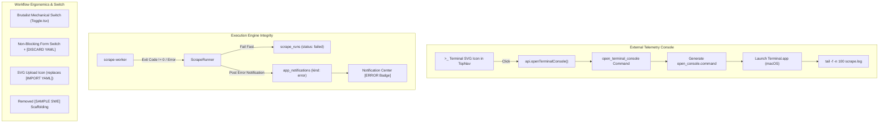

# Phase 3.10 — External Terminal Console, Error Notifications & Workflow Hardening

**Goal:** Deliver a native external Terminal console launcher via a discrete top-bar SVG icon, integrate a robust error notification lifecycle with cherry-red badges in the notification center, fix execution run status integrity for failed workflow configs, eliminate YAML mode lockouts with non-blocking recovery, replace text buttons with brutalist SVG icons, remove sample SWE tags, and upgrade workflow toggles to brutalist mechanical switches.

← [Phase 3.9](./03e-notifications-and-updater.md) · [Master Plan](./00-master-plan.md) · Next → [Phase 4](./04-metrics-dashboard.md)

---

## 1. Architectural Overview & Industry Patterns

---

## 2. Core Functional Requirements

### 2.1 Native External Terminal Console
1. **TopNav Trigger:** An SVG terminal button `>_` placed directly adjacent to the notification bell in the top-right header.
2. **Backend Stream Pipeline:** A persistent log file `scrape.log` in `app_data_dir`, capturing `tracing`, runner events, sidecar stdout/stderr, and worker failures.
3. **Command Launcher:** `open_terminal_console` Tauri command creates/ensures an executable script and launches Terminal.app streaming `tail -f -n 100 <app_data_dir>/scrape.log`.

### 2.2 Execution Run Status Integrity & Failure Diagnostics
1. **Sidecar Process Exit Handling:** If `CommandEvent::Terminated` reports a non-zero exit code (`code != Some(0)`) or `CommandEvent::Error` occurs, the run is finalized with `RunStatus::Failed` and the exit code is recorded in `scrape_runs.error`.
2. **Missing Status Elimination:** Eliminate the fallback that defaults unrecorded sources to `"ok"`. Any source without explicit completion events defaults to `("error", Some("Worker terminated unexpectedly"))`.
3. **Zero-Extraction Diagnostic Warning:** For custom selector workflows where HTTP succeeded but 0 items matched the container selector, record a warning in logs: `"Zero postings extracted. Container selector did not match any HTML elements on page."`
4. **Automated Error Notification:** When a scrape run fails, dispatch an in-app error notification to the notification center.

### 2.3 In-App Error Notifications (`kind: "error"`)
1. **Notification Schema:** Add `Error` variant to `NotificationKind` in Rust (`update`, `news`, `system`, `scraper`, `error`).
2. **Tauri Command:** Expose `create_notification(input: CreateNotificationInput)` to allow frontend and runner services to record persistent notifications.
3. **Visual Styling:** Render error notifications in `NotificationPopover` with a high-contrast cherry-red badge (`bg-[var(--color-cherry)] text-white border-[var(--color-cherry)]` with label `[ERROR]`).
4. **Deep-Linking:** Clicking an error notification navigates to the relevant workflow or console log context.

### 2.4 Removal of "SAMPLE SWE" Scaffolding
1. Remove `[ SAMPLE SWE ]` tag/button from [`AddSourceModal.tsx`](../src/components/views/settings/AddSourceModal.tsx).
2. Remove `+ SAMPLE SWE` button from the header toolbar of [`SourcesSettings.tsx`](../src/components/views/settings/SourcesSettings.tsx).
3. The sample workflow remains cleanly seeded in SQLite via startup initialization and the empty-state fallback.

### 2.5 YAML View Lockout Remediation
1. **URL Canonicalization:** Automatically expand ATS slugs into canonical URLs (`https://boards.greenhouse.io/{slug}`) when loading sources and serializing to YAML v2.
2. **Permissive Slug Support:** In `validateWorkflowYaml`, accept valid alphanumeric slugs for standard ATS kinds (`greenhouse`, `lever`, `ashby`).
3. **Non-Blocking Recovery:** If YAML parses into a JavaScript object, apply valid properties and transition to Form view. If syntax errors exist, show the error, log an error notification, and provide an explicit `[ DISCARD YAML & RETURN TO FORM ]` fail-safe.

### 2.6 Brutalist Mechanical Switch Component
1. Refactor [`Toggle.tsx`](../src/components/ui/Toggle.tsx) from a square checkbox with text glyphs (`■`/`□`) into a true brutalist mechanical switch:
   - **Track:** Rectangular trough (`w-8 h-4`), 1px solid border `border-[var(--color-ink)]`, 0px border-radius.
     - OFF: `bg-[var(--color-paper-2)]`
     - ON: `bg-[var(--color-ink)]`
   - **Thumb:** Sharp square block (`w-2.5 h-2.5`), 0px border-radius, sliding between `left-[2px]` and `translate-x-3.5`.
   - **Animation:** `transition-transform duration-150 ease-out`.
   - **Accessibility:** `role="switch"`, `aria-checked`, keyboard focus ring, Space/Enter activation.

---

## 3. Comprehensive Test Plan

### 3.1 Rust Backend Test Suite (`cargo test --workspace`)
1. **Notification Repo & Kinds:**
   - Test serialization/deserialization of `NotificationKind::Error` (`"error"`).
   - Test `NotificationRepo::create` with `NotificationKind::Error`.
   - Test `create_notification` command invocation.
2. **Scrape Runner Failure Integrity:**
   - Test that sidecar exit code != 0 marks run as `RunStatus::Failed`.
   - Test that missing source statuses in `trigger_single_source` map to `RunStatus::Failed` instead of `RunStatus::Success`.
3. **Terminal Console Command:**
   - Test `open_terminal_console` path resolution and script generation in unit test mode.

### 3.2 Frontend Test Suite (`npm test` via Vitest)
1. **Mechanical Switch (`Toggle.test.tsx`):**
   - Renders with `role="switch"` and `aria-checked`.
   - Applies mechanical classes (track `w-8 h-4`, sliding thumb).
   - Toggles state on click and on Space/Enter keyboard events.
2. **YAML Validation & Permissive Slugs (`yaml_workflow.test.ts`):**
   - Validates ATS workflows with plain slugs (e.g. `extractor: { kind: "greenhouse", url: "cloudflare" }`).
   - Validates canonical HTTP/HTTPS URLs.
   - Verifies non-blocking AST recovery on partial specs.
3. **Error Notifications (`notifications.test.ts`):**
   - Tests `KIND_CONFIG.error` styling with `var(--color-cherry)`.
   - Tests `api.createNotification` mock and integration.
4. **Modal Scaffolding & SVG Icons (`workflow_modal.test.ts`):**
   - Verifies `[ SAMPLE SWE ]` is absent from modal header.
   - Verifies SVG upload icon button is rendered with tooltip.
   - Verifies `TopNav` renders terminal console button.
