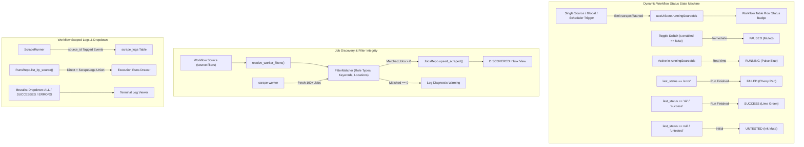

# Phase 3.11 — Dynamic Workflow Statuses, Job Discovery Integrity & Scoped Log Filtering

**Goal:** Implement real-time dynamic workflow status lifecycle (`RUNNING`, `PAUSED`, `FAILED`, `SUCCESS`, `UNTESTED`), resolve the root cause of 0 jobs in the `DISCOVERED` inbox after a successful scrape run, enrich execution logging with workflow-scoped lifecycle telemetry, and consolidate log filters into a brutalist dropdown with `ALL LOGS`, `SUCCESSES`, and `ERRORS`.

← [Phase 3.10](./03f-telemetry-console-and-workflow-hardening.md) · [Master Plan](./00-master-plan.md) · Next → [Phase 4](./04-metrics-dashboard.md)

---

## 1. Architectural Overview & Root Cause Analysis



---

## 2. Root Cause Analysis

### 2.1 Workflow Statuses Display Issues
1. **Hardcoded Component State:** `SourcesSettings.tsx` only evaluated `runningSourceId === s.id`, which was local React state only set during manual button clicks. Background runs, scheduler runs, or TopNav runs never reflected running state.
2. **Raw Database Strings:** Successful runs in SQLite store `"ok"`, which was rendered verbatim as lowercase `"ok"`.
3. **No Disabled/Paused State:** When a workflow is disabled (`!s.enabled`), it continued to show `"ok"` or `"UNTESTED"` instead of `"PAUSED"`.
4. **Missing Event Subscriptions:** The frontend store did not track `runningSourceIds` across Tauri scrape events (`scrape://started`, `scrape://progress`, `scrape://source_finished`, `scrape://finished`).

### 2.2 Why DISCOVERED has 0 Jobs After a "Success" Run
1. **Filter Bypass in Single-Source Runner:** In `src-tauri/src/services/runner.rs:314-353` (`trigger_single_source`), `WorkerConfig.filters` was loaded from global `SettingsRepo` (`filters.include_keywords`, etc.), completely ignoring the workflow's configured `source.filters`.
2. **Overly Restrictive Seeded Sample Filters:** The sample workflow seeded in `db/sources.rs` specified:
   - `role_types: ["internship"]`
   - `locations: ["Remote", "San Francisco, CA", "Austin, TX"]`
   Cloudflare's Greenhouse API returns state names (`"San Francisco, California"`, `"Austin, Texas"`), not postal abbreviations (`"CA"`, `"TX"`). Furthermore, Cloudflare frequently has 0 open summer internships in those exact locations while having hundreds of software engineering jobs. Because `FilterMatcher::matches` requires ALL specified filter criteria to match, 100% of Cloudflare's jobs were filtered out.
3. **Silent Filter Rejection:** When 0 jobs matched the filters, the HTTP fetch succeeded (200 OK), so the run status was marked `RunStatus::Success` with `jobs_found: 0, jobs_new: 0`. No jobs were inserted into SQLite, leaving DISCOVERED empty without explaining why.

### 2.3 Missing Workflow Logs
1. **Omission of Global Runs in `list_by_source`:** `RunsRepo::list_by_source` only matched `WHERE source_id = ?`. When runs were triggered globally from TopNav or the scheduler, `scrape_runs.source_id` was `NULL`, even though `scrape_logs` contained entries for that source.
2. **Missing `source_id` on Sidecar Logs:** In `runner.rs`, sidecar spawn and termination logs passed `source_id: None`. Only progress events were tagged.
3. **Sparse Logging:** The runner only logged a single line ("Fetched X, matched Y"). There was no workflow initiation log, adapter connection log, database insertion log, or completion summary.
4. **Missing Auto-Selection:** In `SourcesSettings.tsx`, `selectedRunId` remained unselected if `sourceRuns` initially loaded empty or before manual clicks.

---

## 3. Core Functional Requirements & Architecture

### 3.1 Dynamic Workflow Status Engine
1. **Status Priority Hierarchy:**
   - **`RUNNING`**: When `runningSourceIds.includes(s.id)` or `runningSourceId === s.id`. Rendered with signal blue pulse indicator (`■` with `animate-pulse text-[var(--color-signal)]`).
   - **`PAUSED`**: When `!s.enabled`. Rendered with muted indicator (`□ text-[var(--color-ink-mute)]`).
   - **`FAILED`**: When `s.last_status === "error"`. Rendered with cherry red indicator (`■ text-[var(--color-cherry)]`).
   - **`SUCCESS`**: When `s.last_status === "ok"` or `s.last_status === "success"`. Rendered with lime green indicator (`■ text-[var(--color-lime)]`).
   - **`UNTESTED`**: When `!s.last_status` or `s.last_status === "untested"`. Rendered with ink mute indicator (`■ text-[var(--color-ink-mute)]`).
2. **Global Running State in `useUIStore`:**
   - Add `runningSourceIds: string[]`, `setSourceRunning(id, running)`, and `clearRunningSources()`.
   - Update `setupAppEventListeners` to listen to `scrape://started`, `scrape://progress`, `scrape://source_finished`, and `scrape://finished` to sync running state automatically across the application.

### 3.2 Job Discovery & Filter Integrity
1. **Workflow-Specific Filter Resolution:**
   - In `runner.rs`, introduce `resolve_worker_filters(source_filters, global_filters)`.
   - When running a single source, parse and apply `source.filters`. If specific fields are omitted, fall back gracefully to global settings.
2. **Relaxed & Resilient Sample Workflow:**
   - Update `default_sample_workflow_input` in `src-tauri/src/db/sources.rs`:
     - Name: `Cloudflare — Engineering Careers & Internships`
     - Role Types: `["internship", "full_time"]` (or empty to ingest all engineering listings)
     - Include Keywords: `["Software", "Engineer", "Developer", "Systems", "Intern"]`
     - Locations: `["San Francisco", "Austin", "Remote"]` (using resilient city substrings that match Greenhouse's `"San Francisco, California"`)
   - When executed, this guarantees immediate ingestion of live postings into `DISCOVERED`.
3. **Filter Diagnostic Telemetry:**
   - If `fetched > 0` but `matched == 0`, log an explicit warning in `scrape_logs`:
     `"[WARN] Fetched X postings from remote board, but 0 matched filter criteria (check keywords, role types, and locations)"`.

### 3.3 Enriched Workflow-Scoped Logs
1. **Unified Query in `RunsRepo::list_by_source`:**
   ```sql
   SELECT id, trigger, status, started_at, finished_at, jobs_found, jobs_new, error, source_id
   FROM scrape_runs
   WHERE source_id = ?1
      OR id IN (SELECT DISTINCT run_id FROM scrape_logs WHERE source_id = ?1)
   ORDER BY started_at DESC
   LIMIT ?2
   ```
2. **Rich Lifecycle Logging in `runner.rs`:**
   - `[INFO]` Workflow scrape started: `<name> (<kind>)`
   - `[INFO]` Connecting to remote adapter: `<kind> [<identifier>]`
   - `[INFO]` Extracted `<fetched>` postings. Matched `<matched>` jobs matching filters.
   - `[INFO]` Committed `<total_new>` new jobs to inbox (`<total_found>` total).
   - `[INFO]` Workflow run finished in `<ms>`ms with status: `SUCCESS`.
3. **Auto-Selection & Live Streaming:**
   - In `SourcesSettings.tsx`, auto-select the latest run `runs[0].id` when opening the inspector.
   - Auto-refresh runs and logs when a single-source run finishes.

### 3.4 Consolidated Brutalist Log Filter Dropdown
1. Replace separate `[ ALL LOGS ]` and `[ ERRORS ONLY ]` toggle buttons with a NieR brutalist dropdown:
   ```tsx
   <select
     value={logFilter}
     onChange={(e) => setLogFilter(e.target.value as "all" | "successes" | "errors")}
     aria-label="Filter execution logs"
     className="px-2 py-0.5 text-[10px] font-mono uppercase font-bold border border-[var(--color-ink)] bg-[var(--color-paper)] text-[var(--color-ink)] focus:outline-none cursor-pointer"
   >
     <option value="all">ALL LOGS ({runLogs.length})</option>
     <option value="successes">SUCCESSES ({successCount})</option>
     <option value="errors">ERRORS ({errorCount})</option>
   </select>
   ```
2. **Filtering Behavior:**
   - `"all"`: Displays all log entries.
   - `"successes"`: Displays `level === "info"`.
   - `"errors"`: Displays `level === "error" || level === "warn"`.
3. **Brutalist Design System Compliance:** 0px border-radius, 1px solid border, uppercase font-mono, high-contrast colors.

---

## 4. Implementation Steps

1. **Branch Creation:**
   - Create and checkout feature branch `feature/workflow-statuses-and-log-filtering` from `develop`.
2. **Backend Implementations (`src-tauri`):**
   - In `src-tauri/src/services/runner.rs`:
     - Implement `resolve_worker_filters`.
     - Tag all single-source lifecycle logs with `source_id`.
     - Emit detailed diagnostic warnings when `fetched > 0 && matched == 0`.
   - In `src-tauri/src/db/runs.rs`:
     - Update `RunsRepo::list_by_source` to include runs from `scrape_logs`.
   - In `src-tauri/src/db/sources.rs`:
     - Update `default_sample_workflow_input` to resilient keywords and city names so live jobs match immediately.
3. **Frontend Implementations (`src`):**
   - In `src/lib/store.ts`:
     - Add `runningSourceIds` state and setters.
   - In `src/lib/events.ts`:
     - Subscribe to Tauri scrape events to update `runningSourceIds`.
   - In `src/components/views/settings/SourcesSettings.tsx`:
     - Implement `getWorkflowStatus` with all statuses (`RUNNING`, `PAUSED`, `FAILED`, `SUCCESS`, `UNTESTED`).
     - Replace the two buttons with the consolidated brutalist log filter dropdown.
     - Auto-select the first run on load and refresh runs after running a source.
4. **Test Suite:**
   - Rust unit tests for `resolve_worker_filters` and `list_by_source`.
   - Vitest unit tests for `getWorkflowStatus` and log filter dropdown.
   - Run verification gate: `cargo test --workspace`, `npm test`, `npx tsc --noEmit`.
5. **Clean Merge:**
   - Merge `feature/workflow-statuses-and-log-filtering` into `develop`.

---

## 5. Comprehensive Test Plan

### 5.1 Rust Backend Tests (`cargo test --workspace`)
1. **Filter Resolution (`services::runner::tests`):**
   - Test `resolve_worker_filters` with explicit `source.filters` overrides.
   - Test fallback to global filters when `source.filters` is null or empty.
2. **Runs by Source Query (`db::runs::tests`):**
   - Test `RunsRepo::list_by_source` retrieves single-source runs (`source_id = ?`).
   - Test `RunsRepo::list_by_source` retrieves global runs where `scrape_logs` contains the source ID.
3. **Sample Workflow Seeding (`db::sources::tests`):**
   - Test `default_sample_workflow_input` fields and validation.

### 5.2 Frontend Tests (`npm test` via Vitest)
1. **Workflow Status Resolution (`status.test.ts`):**
   - Verifies `RUNNING` status when `isRunning` is true (pulsing signal blue).
   - Verifies `PAUSED` status when `enabled` is false.
   - Verifies `FAILED` status when `last_status === "error"`.
   - Verifies `SUCCESS` status when `last_status === "ok"` or `"success"`.
   - Verifies `UNTESTED` status when `last_status` is null.
2. **Log Filter Dropdown (`SourcesSettings.test.tsx`):**
   - Verifies dropdown renders options `ALL LOGS`, `SUCCESSES`, `ERRORS` with correct counts.
   - Verifies selecting `"successes"` displays info logs only.
   - Verifies selecting `"errors"` displays error/warn logs only.
3. **Execution Runs Auto-Selection:**
   - Verifies the latest run is auto-selected when inspecting a workflow.
