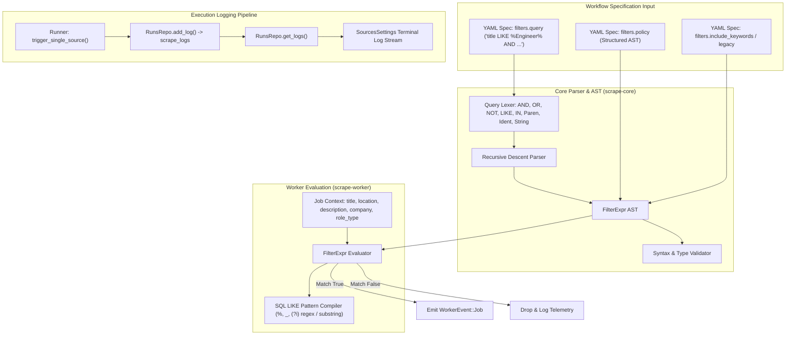

# Phase 3.12 Architecture & Implementation Plan: Expressive Workflow Filter Policy Engine & Execution Logging Verification

> [!NOTE]
> **Status: COMPLETED & VERIFIED**
> - 174 Rust tests passing cleanly across workspace.
> - 286 Vitest tests passing cleanly across 36 test files.
> - `cargo clippy --all-targets -- -D warnings` and `cargo fmt --check` 100% clean.
> - Sidecar binary built and updated in `src-tauri/binaries/`.
> - Expressive SQL LIKE and boolean policy engine operational in core, worker, YAML spec, and AddSourceModal UI.
> - Automated end-to-end execution logging tests verified.

---

## 1. Deep Root Cause Analysis

### Issue A: Why Execution Logs Were Missing When Hitting "RUN"

1. **Sidecar Process Deadlock on Stdin (`read_to_string` waiting for EOF)**:
   - In `crates/scrape-worker/src/main.rs:69`:
     ```rust
     async fn run_stdin_config(dry_run: bool) -> Result<(), Box<dyn std::error::Error>> {
         let mut input = String::new();
         io::stdin().read_to_string(&mut input)?; // BLOCKS WAITING FOR EOF
         let config: WorkerConfig = serde_json::from_str(&input)?;
     ```
   - In `src-tauri/src/services/runner.rs:612` and `commands/scrape.rs:128`:
     ```rust
     let config_bytes = serde_json::to_vec(&config)?;
     child.write(&config_bytes)?;
     ```
   - In Tauri v2 shell plugin, `child.write(&config_bytes)` writes raw JSON bytes into the stdin pipe, but **does not close stdin**. `child` is kept in scope to track process lifecycle.
   - Because `read_to_string` waits for EOF (pipe close), `scrape-worker` hung indefinitely waiting for EOF on stdin!
   - After 180 seconds, the runner's `timeout` triggered, killing the sidecar and returning an error.
   - **Resolution**:
     - Switch stdin ingestion to line-delimited NDJSON (`io::stdin().read_line(&mut input)`).
     - Have the host append `\n` to `config_bytes` before writing. The worker parses the JSON immediately without waiting for EOF.

2. **Frontend Run & Log Desync in `SourcesSettings.tsx`**:
   - In `handleRunSourceNow`:
     ```tsx
     await api.runSourceNow(source.id);
     fetchSources();
     const runs = await api.listSourceRuns(source.id, 10).catch(() => []);
     setSourceRuns(runs);
     if (runs[0]) setSelectedRunId(runs[0].id);
     ```
   - If `api.runSourceNow` threw an error (such as worker timeout or exit), the `catch (e)` swallowed it and skipped `listSourceRuns`, leaving runs empty and logs blank.
   - If `runs[0].id` happened to be equal to `selectedRunId`, React skipped re-running `useEffect([selectedRunId])`, so `api.getScrapeLogs` was never invoked.
   - `SourcesSettings.tsx` did not listen to Tauri events (`scrape://started`, `scrape://progress`, `scrape://source_finished`, `scrape://finished`), so the drawer never refreshed live during background execution.
   - **Resolution**:
     - Guarantee that `listSourceRuns` and `getScrapeLogs(runs[0].id)` are always fetched (even if a run failed), and set `setRunLogs(logs)` directly in state.
     - Add Tauri event listeners in `SourcesSettings.tsx` to dynamically update runs and stream logs in real time.

3. **Missing Automated Logging Test**:
   - There was no automated test verifying that calling `trigger_single_source` or `start_with_source`:
     - Creates a run in `scrape_runs`.
     - Inserts lifecycle log entries in `scrape_logs` (`initiated`, `spawned`, `progress`, `finished`).
     - Querying `RunsRepo::get_logs(&pool, run_id)` returns non-empty logs with correct messages and levels.

---

### Issue B: The Need for an Expressive Workflow Filter Policy Engine

1. **Current Limitations**:
   - `WorkerFilters` only supports four flat string lists: `include_keywords`, `exclude_keywords`, `locations`, `role_types`.
   - All `include_keywords` were evaluated with loose `OR` logic across `title` and `location`.
   - All `exclude_keywords` were evaluated with `OR` logic.
   - `locations` were evaluated with `OR` logic.
   - **Cannot express boolean combinations**: Cannot say `"Must have (Software OR Systems) AND (Intern OR Internship)"`.
   - **Cannot express field specificity**: Cannot distinguish `title LIKE '%Engineer%'` from `description LIKE '%Engineer%'`.
   - **Rigid substring matching**: Cannot perform prefix (`value%`), suffix (`%value`), or exact pattern matching.

2. **User Requirements**:
   - Custom logic and policy control.
   - "Must have [Word] or [Word]" vs "Must contain [Word] AND [Word]".
   - SQL-like wildcards: `LIKE '%value'`, `value%`, `%value%`, `_` single character wildcard, exact match, case-insensitivity.
   - Targetable fields: `title`, `location`, `description`, `company`, `role_type`.
   - Expressible in both YAML specification and UI.

---

## 2. Technical Architecture: Workflow Filter Policy Engine



---

## 3. Query Language Grammar & AST Design

### 3.1 SQL-Like Query Syntax

Users can write boolean expressions in `filters.query`:

```text
query: "title LIKE '%Engineer%' AND (location LIKE '%Remote%' OR location LIKE '%San Francisco%') AND title NOT LIKE '%Senior%'"
```

Supported syntax:
- **Logical Operators**: `AND`, `OR`, `NOT` (case-insensitive), with standard operator precedence (`NOT` > `AND` > `OR`) and parentheses `(...)`.
- **Comparison Operators**:
  - `LIKE` / `ILIKE`: SQL wildcard matching (`%` = zero or more chars, `_` = single char). Always case-insensitive.
  - `NOT LIKE`: Negated SQL wildcard match.
  - `CONTAINS` / `NOT CONTAINS`: Substring match.
  - `=`, `==`, `!=`, `<>`: Exact equality or inequality.
  - `IN (...)` / `NOT IN (...)`: Membership in a list of literals.
- **Fields**:
  - `title`: Job title.
  - `location`: Location string.
  - `description` / `desc`: Plaintext job description.
  - `company`: Company name.
  - `role_type`: Role type enum (`internship`, `full_time`, `contract`, etc.).
- **Untargeted / Shorthand Literals**:
  - `'Engineer' AND ('Intern' OR 'Co-op')`
  - When no field is specified, matches across `title` OR `description`.

### 3.2 Structured YAML Policy Syntax (Alternative to Query String)

```yaml
filters:
  policy:
    all: # AND
      - any: # OR
          - title: "%Engineer%"
          - title: "%Developer%"
      - any:
          - location: "%Remote%"
          - location: "%San Francisco%"
      - none: # NOT
          - title: "%Senior%"
          - title: "%Staff%"
```

### 3.3 Core AST Definition (`crates/scrape-core/src/filter.rs`)

```rust
#[derive(Debug, Clone, Serialize, Deserialize, TS, PartialEq)]
#[serde(tag = "type", content = "data", rename_all = "snake_case")]
pub enum FilterExpr {
    FieldMatch {
        field: FilterField,
        op: FilterOp,
        value: String,
    },
    FieldIn {
        field: FilterField,
        values: Vec<String>,
        negated: bool,
    },
    TextMatch {
        pattern: String,
        negated: bool,
    },
    And(Vec<FilterExpr>),
    Or(Vec<FilterExpr>),
    Not(Box<FilterExpr>),
    AlwaysTrue,
    AlwaysFalse,
}

#[derive(Debug, Clone, Copy, Serialize, Deserialize, TS, PartialEq, Eq)]
#[serde(rename_all = "snake_case")]
pub enum FilterField {
    Title,
    Location,
    Description,
    Company,
    RoleType,
}

#[derive(Debug, Clone, Copy, Serialize, Deserialize, TS, PartialEq, Eq)]
#[serde(rename_all = "snake_case")]
pub enum FilterOp {
    Like,
    NotLike,
    Contains,
    NotContains,
    Equals,
    NotEquals,
}
```

### 3.4 SQL Wildcard Pattern Matching Algorithm

The SQL pattern `%val%` translates to:
1. Pure contains: If pattern is `%val%` and has no internal wildcards, evaluate `haystack_lower.contains(needle_lower)`.
2. Starts with: `val%` evaluates `haystack_lower.starts_with(needle_lower)`.
3. Ends with: `%val` evaluates `haystack_lower.ends_with(needle_lower)`.
4. Arbitrary pattern: Compile to regex with escaped characters, `%` -> `.*`, `_` -> `.`, anchored as `^(?i)...$`.

---

## 4. Execution Logging Fix & Test Strategy

### 4.1 Backend Runner Fixes
1. **Fix Sidecar Stdin Protocol**:
   - `crates/scrape-worker/src/main.rs`: Read stdin using `BufReader::read_line`.
   - `src-tauri/src/services/runner.rs` and `commands/scrape.rs`: Send `config_bytes` with trailing `\n`.
2. **Scope All Runner Logs**:
   - In `trigger_single_source`, ensure all log events (`initiated`, `spawned`, `progress`, `exit`, `finished`) pass `Some(source_id)`.
3. **Automated Integration Test in Rust**:
   - Add `test_single_source_execution_logs_end_to_end` in `runner.rs` / `runs.rs`.
   - Verifies that running a single-source scrape inserts a run and creates at least 3-4 sequential logs in `scrape_logs`.
   - Asserts that `RunsRepo::get_logs(&pool, run_id)` returns non-empty logs with expected contents.
   - Asserts that `RunsRepo::list_by_source(&pool, source_id, 10)` returns the run.

### 4.2 Frontend Terminal Viewer Fixes
1. **Direct State Sync in `SourcesSettings.tsx`**:
   - In `handleRunSourceNow`, wrap in try/finally to guarantee `listSourceRuns` is refreshed regardless of success or failure.
   - Fetch `api.getScrapeLogs(runs[0].id)` directly and update `setRunLogs(logs)`.
2. **Real-Time Event Listeners**:
   - Listen to `scrape://started`, `scrape://progress`, `scrape://source_finished` inside `SourcesSettings.tsx` so the log stream updates dynamically.
3. **Vitest Unit & Integration Tests**:
   - Add tests asserting that when a run is completed, logs are loaded and rendered in the terminal log viewer.
   - Test log filter dropdown (`ALL LOGS`, `SUCCESSES`, `ERRORS`).

---

## 5. Implementation Roadmap & Steps

| Phase | Component | File Targets | Deliverables |
|---|---|---|---|
| **Phase 1** | Stdin Protocol & Runner Logs Fix | `crates/scrape-worker/src/main.rs`, `src-tauri/src/services/runner.rs`, `src-tauri/src/commands/scrape.rs` | Unblock sidecar stdin with NDJSON line reading; ensure full source tagging on logs. |
| **Phase 2** | Automated Rust Logging Tests | `src-tauri/src/services/runner.rs`, `src-tauri/src/db/runs.rs` | Automated integration tests asserting `scrape_logs` population and retrieval. |
| **Phase 3** | Frontend Log Sync & Events | `src/components/views/settings/SourcesSettings.tsx` | Fix run selection desync, add Tauri event listeners for real-time log updates. |
| **Phase 4** | Filter AST & Lexer/Parser | `crates/scrape-core/src/filter.rs`, `crates/scrape-core/src/protocol.rs` | Recursive descent parser for SQL boolean expressions and SQL `LIKE` wildcard compiler. |
| **Phase 5** | Worker Filter Evaluator | `crates/scrape-worker/src/filter.rs`, `crates/scrape-worker/src/main.rs` | Evaluate `FilterExpr` against job postings; support boolean logic and wildcards. |
| **Phase 6** | YAML Workflow Spec Update | `src/lib/yamlWorkflow.ts`, `workflows/software-engineering-internships.yaml` | Add `query` and `policy` support to YAML schema, parser, and validator. |
| **Phase 7** | Frontend UI & Testing | `src/components/views/settings/AddSourceModal.tsx`, `src/test/*` | Add query hints in modal; write full Vitest and Rust test coverage. |

---

## 6. Verification Gates

1. **Rust Tests**: `cargo test --workspace` (all 167+ tests plus new policy parser and logging tests pass).
2. **Clippy & Formatting**: `cargo clippy -- -D warnings`, `cargo fmt --check`.
3. **TypeScript & Vitest**: `npx tsc --noEmit`, `npm test` (all 283+ tests pass).
4. **End-to-End Workflow Validation**:
   - Run sample Cloudflare workflow with `query: "title LIKE '%Engineer%' AND (location LIKE '%Remote%' OR location LIKE '%San Francisco%')"`:
   - Verify logs stream into SQLite and display in terminal view.
   - Verify matched jobs appear in Discovered inbox.
