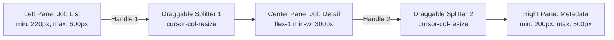

# Phase 3.13 Architecture & Implementation Plan: Discovered Panes Ergonomics, Resizable Window Dividers, Prominent Favorite SVG, Job Description Columns, Deduplication Idempotency & Company Icons

> [!NOTE]
> **Status: SPECIFICATION & DESIGN REVIEW**
> Builds upon: [00-Master Plan](./00-master-plan.md), [03-Frontend UI](./03-frontend-ui.md), [03h-Workflow Policy Engine](./03h-workflow-policy-engine-and-execution-log-test.md).

---

## 1. Executive Summary & Root Cause Analysis

Based on user testing and QA feedback, five critical improvements are required for the Discovered inbox and scraping pipeline:

1. **Static Panes in Discovered Inbox**:
   - `ThreeColumn.tsx` hardcoded `w-80` (320px) on the left, `flex-1` in the center, and `w-72` (288px) on the right with static `<Rule orientation="vertical" />`.
   - Users on varied display resolutions cannot adjust pane boundaries to give more room to long role titles, wide descriptions, or triage actions.
   - **Resolution**: Convert vertical dividers into draggable, desktop-grade window splitters with pointer capture, min/max boundary clamps, double-click to reset, keyboard arrow key controls, and `localStorage` layout persistence.

2. **Inconspicuous Favorite Button**:
   - Favorite state currently uses tiny unicode text glyphs (`{job.favorited ? "★" : "☆"}`) with `text-xs px-0.5`.
   - On high-DPI screens, the glyph is faint, lacks clear click feedback, and does not stand out as an actionable safety shield.
   - **Resolution**: Implement a dedicated `<FavoriteButton>` component featuring a crisp, geometric 5-point brutalist SVG star (18px-20px), bold `var(--color-lime)` active fill with 1.5px solid boundary stroke, and clear hover/focus contrast.

3. **Job Description Omission & Missing Table Column**:
   - `JobDetail.tsx` completely omitted `job.description_text` from the DOM, only showing titles, tags, and candidate notes.
   - Discovered view lacked a table mode and list description previews, preventing quick scanning of requirements or tech stacks.
   - **Resolution**: 
     - Add a prominent `JOB DESCRIPTION` card to `JobDetail.tsx` displaying the full extracted plain text with whitespace preservation.
     - Add a view mode toggle in `DiscoveredView.tsx` (`[SPLIT PANE]` vs `[TABLE]`), featuring a dedicated `DESCRIPTION & RELEVANT INFO` column in table mode alongside list row description previews.
     - Add a `DESCRIPTION` column to `TrackedList.tsx` for consistent cross-view parity.
     - Ensure all scraper adapters extract and preserve plain-text job descriptions.

4. **Scraper Deduplication Breakdown on Workflow Re-Runs**:
   - Running the same workflow multiple times in dev mode generated duplicate postings in Discovered inbox.
   - **Root Cause**: `generateScrapedJobsForSource` in `src/lib/api.ts` used `Date.now()` inside `jobId` and `dedupe_key`, and `runSourceNow` unconditionally called `devJobs.unshift(...newJobs)`.
   - **Resolution**: Make `dedupe_key` and `jobId` deterministic based on source identifier and role title slug. Implement SQLite-parity upsert in `devJobs` where existing keys refresh `last_seen_at` without resetting user triage status (`status`), and only newly discovered postings increment `jobs_new`.

5. **Company Icon Scraping & Brutalist Display**:
   - Postings currently display text-only company names without brand icons or favicons.
   - **Resolution**:
     - Database migration `0008_company_icon.sql` adding `company_icon_url TEXT` to `jobs` and `sources`.
     - Scraper extraction of company logos from ATS endpoints, JSON-LD `hiringOrganization.logo`, HTML icons, and Google Favicon service (`https://www.google.com/s2/favicons?domain=${domain}&sz=64`).
     - Reusable `<CompanyLogo>` component with 0px brutalist border, pixelated image rendering, and high-contrast letter monogram fallback.

---

## 2. Architecture & Detailed Specifications

### 2.1 Resizable Window Panes (`ThreeColumn.tsx`)



- **Pointer Capture & Math**:
  - `onPointerDown`: captures `pointerId` via `e.currentTarget.setPointerCapture(e.pointerId)`.
  - For left handle: `clientX - containerRect.left` clamped to `[220px, 600px]`.
  - For right handle: `containerRect.right - clientX` clamped to `[200px, 500px]`.
- **Reset & Accessibility**:
  - Double click on handle resets Left to `320px` and Right to `288px`.
  - Keyboard accessibility: `role="separator"`, `tabIndex={0}`, `aria-valuenow`, `ArrowLeft`/`ArrowRight` adjustments.
- **Persistence**:
  - Debounced write to `localStorage` (`scrape:layout:left_pane_width`, `scrape:layout:right_pane_width`).

### 2.2 Brutalist Favorite Button Component (`FavoriteButton.tsx`)

- **Component API**:
  ```tsx
  interface FavoriteButtonProps {
    favorited: boolean;
    onToggle: () => void;
    size?: "sm" | "md" | "lg";
    shortcutHint?: string;
    className?: string;
  }
  ```
- **Styling**:
  - 5-point SVG polygon:
    ```svg
    <polygon points="12,2 15.09,8.26 22,9.27 17,14.14 18.18,21.02 12,17.77 5.82,21.02 7,14.14 2,9.27 8.91,8.26" />
    ```
  - Favorited: `fill: var(--color-lime)`, `stroke: var(--color-ink)`, `stroke-width: 1.5px`.
  - Unfavorited: `fill: transparent`, `stroke: var(--color-ink-mute)`, hover to `var(--color-ink)`.

### 2.3 Job Description & Table Column Parity

- **`JobDetail.tsx`**:
  - Boxed section titled `JOB DESCRIPTION ▏`.
  - Monospace/sans container with `whitespace-pre-wrap` and `text-xs leading-relaxed`.
- **`DiscoveredView.tsx`**:
  - Mode switch in sub-header: `[3-PANE]` / `[TABLE]`.
  - In `TABLE` mode: columns `[★] [COMPANY] [TITLE] [DESCRIPTION] [STATUS] [SALARY] [LOCATION] [YOE] [GRAD] [SPON] [CLR] [ADDED] [ACTIONS]`.
  - In `3-PANE` mode: list rows display a 2-line snippet of `description_text`.
- **`TrackedList.tsx`**:
  - Add `DESCRIPTION` column between `JOB TITLE` and `STAGE`.

### 2.4 Deduplication Engine

- **Deterministic Key Generation**:
  - `dedupe_key = "${source.identifier}:${role_slug}"`
  - `job_id = "job-${source.identifier}-${role_slug}"`
- **Upsert Algorithm**:
  ```ts
  const existing = devJobs.find(j => j.dedupe_key === candidate.dedupe_key || j.url === candidate.url);
  if (existing) {
    existing.last_seen_at = now;
    // preserve triage status (applied, ignored, favorited, notes)
  } else {
    devJobs.unshift(candidate);
    newCount++;
  }
  ```

### 2.5 Company Icon Pipeline

- **Migration `0008_company_icon.sql`**:
  ```sql
  ALTER TABLE jobs ADD COLUMN company_icon_url TEXT;
  ALTER TABLE sources ADD COLUMN company_icon_url TEXT;
  ```
- **Rust Backend**:
  - Add `company_icon_url: Option<String>` to `WorkerEvent::Job`, `ScrapedJob`, and `Job`.
  - Update `JobsRepo` queries and `upsert_scraped`.
- **Component `<CompanyLogo>`**:
  - Size: 20x20px (sm), 24x24px (md), 32x32px (lg).
  - Image rendering: `pixelated`, `border: 1px solid var(--color-ink)`.
  - Monogram fallback on load error: uppercase company initial inside a paper-2 square.

---

## 3. Verification & Testing Matrix

| Suite | Component / Area | Verification Criteria |
|---|---|---|
| **Vitest** | `ThreeColumn.tsx` | Dragging handle updates widths within min/max bounds; double-click resets to defaults; localStorage persists width. |
| **Vitest** | `FavoriteButton.tsx` | Renders SVG with correct fill/stroke based on `favorited`; triggers `onToggle`; accessible aria labels. |
| **Vitest** | `DiscoveredView.tsx` | Toggle between 3-Pane and Table mode; renders description snippet and description column; selection works across modes. |
| **Vitest** | `JobDetail.tsx` | Renders `job.description_text` section cleanly with fallback for empty descriptions. |
| **Vitest** | `api.ts` (dev mode) | Running `runSourceNow` twice does not duplicate jobs in `devJobs`; refreshes `last_seen_at`; preserves favorited/applied state. |
| **Vitest** | `CompanyLogo.tsx` | Renders image when URL provided; falls back to monogram on error. |
| **Rust** | `JobsRepo` & Migration | Migration 0008 applies cleanly; `upsert_scraped` updates `company_icon_url`; all 174+ cargo tests pass. |
